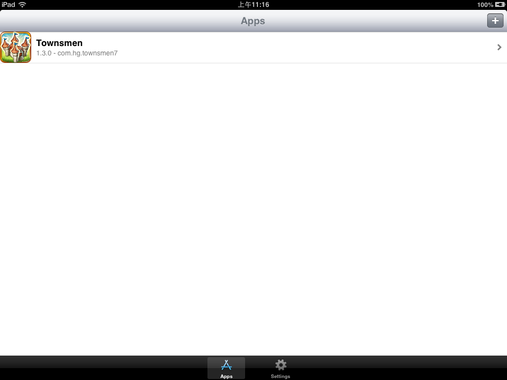
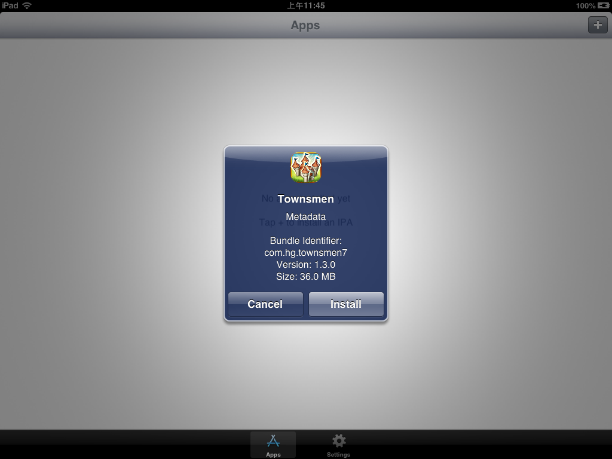

# OldTroll

  

<strong>One-tap IPA installer for legacy iOS devices.</strong> 
armv7 · iOS 6–10

---

## Usage

Open OldTroll, tap **+**, then choose **Install IPA File** or **Install from URL**. Pick or paste an IPA, confirm the app details, and tap **Install** — the rest is handled by the bundled AppSync runtime.

---

## Screenshots

  
  

---

## Demo

<video src="run.mp4" controls width="100%"></video>

[Watch run.mp4](run.mp4)
